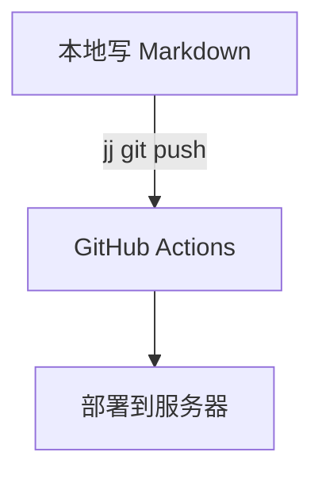

# 十五的博客

> 记录计算机、AI 与日常折腾的个人博客。

线上站点：**https://blog.shiwu.dev**

基于 [Astro](https://astro.build/) 静态构建，主题使用开源的 [LogFlow Theme](https://github.com/kevynf/logflow-theme)（MIT 协议），并做了个人化改造：石墨灰单色主题、文字雪背景、适配手机的 GitHub 活跃度图、Mermaid 图表、明暗主题切换。

## 快速开始

要求 Node.js `>= 22.12.0`（推荐 24）。

```bash
npm ci            # 安装依赖
npm run dev       # 本地开发：http://localhost:4321
```

| 命令 | 说明 |
| --- | --- |
| `npm run dev` | 启动开发服务器，支持热更新 |
| `npm run build` | 构建静态站点到 `dist/` |
| `npm run preview` | 预览构建结果 |
| `npm run check` | Astro + TypeScript 类型检查 |
| `node scripts/check-site.mjs` | 本地站点自检（需先启动 `npm run dev`，默认检查 `127.0.0.1:4321`） |
| `node scripts/verify-live.mjs` | 线上验收（默认检查 `https://blog.shiwu.dev`） |

> **Windows 沙箱兼容**：Vite 在 Windows 上会调用 `net use` 探测网络驱动器，在限制子进程的沙箱里会抛错导致构建失败。npm 脚本通过预加载 `scripts/net-use-shim.cjs` 给这条命令做了兜底；普通开发机和部署环境不受影响，想恢复纯 `astro` 命令直接改 `package.json` 即可。

### 本地看效果

```bash
npm run dev   # http://localhost:4321
```

建议顺手检查这几处：

- 首页：最新（或标记 `featured`）的文章会显示成精选大卡；头像有细描边；向下滚动后页头出现投影。
- 文章页：宽屏（≥ 80rem）左侧有固定目录；窄屏在标题卡里折叠成「目录」，滚动时当前小节高亮。
- 点正文图片会打开大图，`Esc` 或点背景关闭。
- 切换明暗主题，部署流程图会换成暗色版本。
- 文末有签名和 RSS 订阅；发布第二篇文章后会出现上一篇/下一篇与相关文章。
- 滚动超过一屏后右下角出现「回到顶部」。

## 目录结构

| 路径 | 用途 |
| --- | --- |
| `src/consts.ts` | 站点信息、导航、社交链接、首页文案、搜索/评论/活跃度开关 |
| `src/content/blog/` | 文章源文件，文件名即 URL slug |
| `src/content/about/index.md` | 关于页正文 |
| `src/config/friend-links.ts` | 友链数据 |
| `src/styles/global.css` | 设计令牌（Tailwind v4 `@theme`）与文章排版样式 |
| `src/assets/fonts/` | 正文衬线字体子集（Noto Serif SC 400） |
| `src/components/` | 页头、文字雪、GitHub 活跃度、Mermaid 渲染、文章目录、图片灯箱等组件 |
| `src/pages/` | 首页、文章、归档、专题/标签、友链、关于、RSS、搜索索引 |
| `public/` | 头像、favicon、文章配图 |
| `scripts/` | 站点自检脚本与 net-use shim |
| `deploy/` | 服务器部署脚本、Caddy 与 Cloudflare 配置 |
| `.github/workflows/deploy.yml` | GitHub Actions 自动构建与部署 |

## 个性化配置

### 站点信息

个人化配置集中在 `src/consts.ts`：

| 配置 | 说明 |
| --- | --- |
| `SITE_TITLE` / `SITE_DESCRIPTION` | 站点标题与默认 SEO 描述 |
| `SITE_URL` | 生产站点地址，sitemap、canonical 与 RSS 都使用它 |
| `COPYRIGHT_NAME` | 页脚版权署名 |
| `PAGE_COPY` | 各页面的标题与描述 |
| `NAV_LINKS` | 顶部导航 |
| `SOCIAL_LINKS` | 页脚社交链接（GitHub、邮箱等） |
| `HOME` | 首页头像、简介、格言、文章数量 |
| `GH_CONTRIBUTE` | GitHub 活跃度区块 |
| `COMMENTS` | giscus 评论配置 |
| `SEARCH` | 全站搜索开关与最大结果数 |

### 视觉

设计令牌集中在 `src/styles/global.css` 顶部的 `@theme` 与 `.dark`，改一处即可全站生效：

- **配色**：`--color-accent` / `--color-link` / `--color-page` / `--color-surface` / `--color-heading` 等。当前是「石墨灰」单色主题——浅色为浅灰纸面 + 石墨强调，暗色为石墨黑 + 亮灰强调。
- **字体**：`--font-sans`（界面与标题）、`--font-serif`（正文，思源宋体 → 宋体回退）、`--font-mono`（代码）。衬线正文只作用于 `Prose` 内容区。
- **排版**：`--text-reading`（正文字号与行高）、`--container-page`（阅读区宽度）、`--radius-box`（卡片圆角）。
- **文字雪**：`src/components/TextSnowCanvas.astro`，零依赖 2D canvas，远/近双层景深，颜色读取 `--ink-rgb` 并跟随明暗主题；系统开启「减少动态效果」时只做静态渲染。想调密度和速度，改组件里的 `POOL`（字库）、数量与 `speed` 区间。
- **头像与 favicon**：`public/avatar.svg`、`public/favicon.svg`。
- **文章阅读**：标题层级、自动目录（宽屏固定在左侧，窄屏折叠在标题卡内）、图片点击放大、文末签名与上一篇/下一篇/相关文章、回到顶部。
- **字体**：正文使用自托管的 Noto Serif SC 400 子集（`src/assets/fonts/`，只含站内用到的字，约 170 KB），访客没装思源宋体也能看到一致的宋体排版。新增文章后如果出现子集里没有的字，会逐字回退到系统字体；想让新字也进入子集时运行 `python scripts/build-font-subset.py`（需先 `pip install fonttools brotli`）。
- **暗色配图**：给 `` 加 `data-dark-src="xxx-dark.svg"`（只写同目录文件名），主题切换时会自动换成暗色版；目前部署流程图有 `timeline-dark.svg`。
- **首页精选**：首页会把最新一篇（或 Frontmatter 里标了 `featured: true` 的文章）显示成精选大卡，其余文章保持列表。

### 文章配图

图片放在 `public/images/` 下，正文里用 `<figure>` + `<figcaption>`，样式（圆角、边框、居中图注）已内置：

```markdown
<figure>
  
  <figcaption>图 1：那天下午的流程</figcaption>
</figure>
```

## 写文章

文章放在 `src/content/blog/`，支持 Markdown 和 MDX，文件名就是 URL。例如 `deploy-blog-with-ai.md` 对应 `/blog/deploy-blog-with-ai/`。

最简 Frontmatter：

```yaml
---
title: 文章标题
description: 一句话摘要
pubDate: 2026-10-17
---
```

可选字段：`updatedDate`、`tags`（数组）、`collection` / `collectionDescription`（专题）、`heroImage`（本地图片）、`featured`（首页精选大卡）、`enableComments`。

### 专题与标签约定

- **专题（collection）** 建议固定几类：`游戏开发`、`AI`、`Linux`、`Rust`、`网络安全`、`折腾日志`
- **标签（tags）** 写更细的关键词，例如：`所有权`、`借用`、`Caddy`、`Cloudflare`、`Cocos Creator`
- 一篇一主题，标题尽量说清楚「读者能获得什么」
- 没有文章时，首页、文章、标签、归档页会自动显示空状态

### Mermaid 图表

在文章里直接用 ` ```mermaid ` 代码块，支持流程图、时序图等：

````markdown

````

渲染在浏览器端按需进行：**只有包含 mermaid 代码块的文章才会加载 Mermaid**，图表配色跟随明暗主题；语法错误或加载失败会回退成原始代码块。

### 写作风格

站内文章希望读起来像人在讲自己的经历，而不是技术文档。语气、结构、配图习惯和「让 AI 帮忙改写」的 Prompt 模板见 [WRITING.md](./WRITING.md)。

## 可选功能

- **GitHub 活跃度**：首页默认显示，免 token 即可工作（走公开统计接口）。想改用 GitHub 官方 GraphQL 数据：
  1. 在 [GitHub Settings → Tokens](https://github.com/settings/tokens) 创建一个只读 token（classic token 勾选 `read:user` 即可，建议设置过期时间）；
  2. 在仓库 `Settings → Secrets and variables → Actions` 里添加 Secret：`GH_TOKEN`；
  3. 工作流会把 `GH_TOKEN` 传给构建步骤，日志里会显示「贡献图数据源：GitHub GraphQL」。

  本地想用官方数据时，把 `.env.example` 复制为 `.env`，填入 `GITHUB_TOKEN=...`；GraphQL 失败会自动回退到公开统计接口。想在贡献图里统计私密贡献，需要在 GitHub 个人资料设置里开启「Include private contributions on my profile」（只显示次数，不暴露仓库内容）。手机端显示最近半年，桌面端显示完整一年；把 `src/consts.ts` 里的 `GH_CONTRIBUTE.enabled` 设为 `false` 可关闭该区块。
- **giscus 评论**：在 GitHub 仓库开启 Discussions，然后把 `src/consts.ts` 中 `COMMENTS` 的 `repo`、`repoId`、`categoryId` 填好，并把 `enabled` 设为 `true`。
- **友链**：在 `src/config/friend-links.ts` 中按 `FriendLink` 接口添加；没有友链时页面会显示空状态提示。
- **搜索**：构建时生成静态索引（只含标题、摘要和标签），按 `Ctrl/⌘ + K` 或 `/` 打开。

## 部署

正式站点在自有 Ubuntu 服务器上，由 Caddy 托管静态文件并自动申请 HTTPS，Cloudflare 负责 DNS 和 CDN。日常发布流程：

```bash
jj commit -m "新文章"   # 提交当前改动
jj git push             # 推送 main 书签
```

推送后由 GitHub Actions 自动完成构建和部署：

```
jj git push → GitHub Actions（npm ci / astro check / astro build）
            → rsync dist/ 到服务器站点目录（/home/shiwu/blog）
            → Caddy 托管 + 自动 HTTPS
            → Cloudflare CDN / DNS
```

- **版本控制**：本站使用 [Jujutsu](https://jj-vcs.github.io/jj/)（jj）而不是 git。工作副本本身就是一个 commit，日常不需要 `git add`；改动推到 GitHub 后同样会触发 Actions。行尾统一为 LF，由 `.editorconfig` 保证。
- **工作流**：push 到 `main` 自动构建并部署；PR 只做构建检查；也支持在 Actions 页面手动触发。
- **服务器配置**：Caddy、Cloudflare、GitHub Secrets 的完整步骤见 [deploy/README.md](./deploy/README.md)。
- **应急手动部署**：`npm run build` 后

  ```bash
  rsync -az --delete -e "ssh -p 22" ./dist/ deploy@<服务器IP>:/home/shiwu/blog/
  ```

`npm run build` 输出在 `dist/`，也可以部署到 Cloudflare Pages、Vercel、Netlify 等静态托管；如果部署在子路径下，用 `SITE_URL=... BASE_PATH=/<repo>` 构建。

## 主题与许可

- 主题来源：[LogFlow Theme](https://github.com/kevynf/logflow-theme)，MIT 协议，原始许可见 [LICENSE](./LICENSE)。
- 本站的个人配置、文章与图片内容版权归作者所有，未经许可请勿直接转载。
