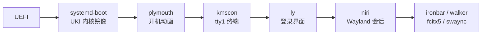
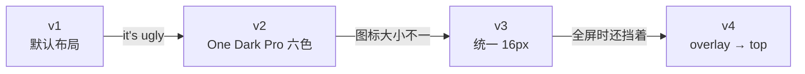
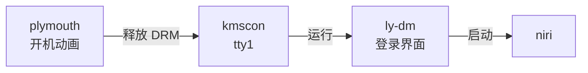
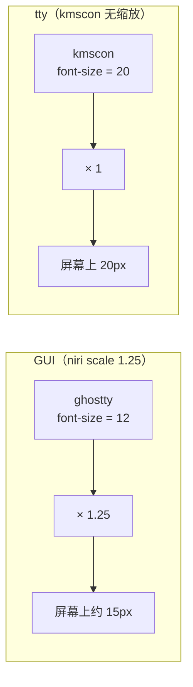
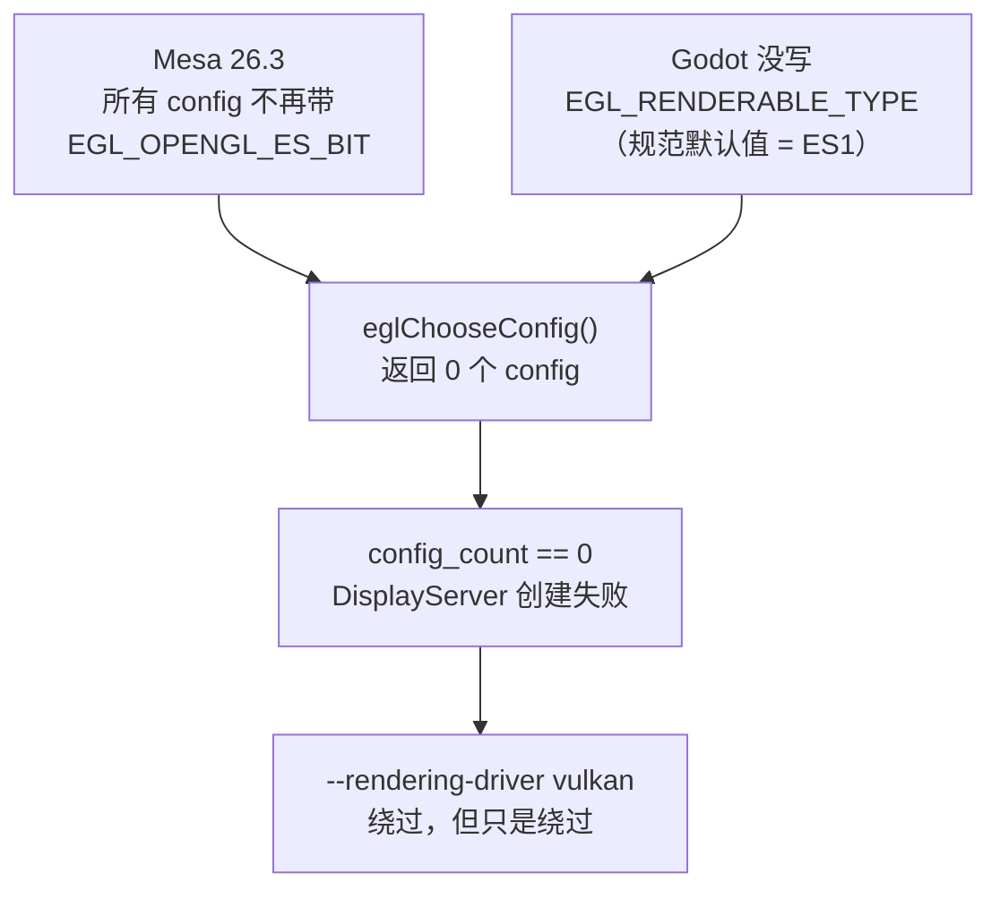

Arch 装完就能开机、能联网、能装包。但默认那一套离「顺手」差得很远：黑底白字的 tty、没有中文、没有状态栏、窗口满屏重叠。

下面这七层，每一层我都换过一次。换的原因不是审美，是默认的某个具体行为让我受不了。

先说清楚它们怎么串起来：



从下往上，一层一层说。

## 第一层：文件系统要能退回去

默认的 ext4 挺好用。换 btrfs 的理由有两个：快照，和内置压缩。

性能上没有普遍优势。默认配置下，btrfs 的随机读写和元数据操作比 ext4 慢，原因是 CoW；开了压缩以后，顺序读写和可压缩数据能反超，随机小写仍然吃亏。Phoronix 今年三月的那轮[文件系统测试](https://phoronix.com/review/linux-612-linux-70-btrfs/2)里，btrfs 默认选项就明显慢于 ext4；Fedora 推动 btrfs 做默认文件系统时也写过，[压缩的收益取决于负载和硬件](https://fedoraproject.org/wiki/Changes/BtrfsTransparentCompression)。

快照让每次改配置前都能退回去，缩分区、刷内核、改引导这些操作之前先打一个。压缩（子卷开的是 `zstd:3`）让同样多的文件占更少的盘。两件事不冲突，不需要取舍。

子卷切成四块：

```text
@       → /
@home   → /home
@pkg    → /var/cache/pacman/pkg
@log    → /var/log
```

分开的理由各不相同。`/home` 要单独快照和恢复；`@pkg` 是包缓存，清了不心疼，但系统崩了能离线装包；`@log` 怕日志写满根分区。`snapper` 管每小时快照。

没有磁盘 swap，只有 4G zram。16G 内存的轻薄本，日常负载用不着 swap；少一个分区，后面装 Windows 时也少一个要处理的交互点。

引导用 systemd-boot + UKI，内核参数直接烧进 `.efi`：

```text
root=PARTUUID=262f86ad-74d9-418c-9b54-879492448bcd rootflags=subvol=@ rootfstype=btrfs
```

**这个 PARTUUID 后来成了硬约束。** 装双系统缩分区时，`p2` 的 UUID 一个字符都不能变，否则 UKI 里的 root 参数指向不存在的设备，直接起不来。

## 第二层：滚动平铺，不是分屏

`niri` 把窗口排成一条从左往右无限延长的带子。不重叠，不手动分屏，滚一下就换焦点。

传统平铺（i3、sway）是把屏幕切成格子，开第五个窗口时你得决定往哪个方向切。niri 不需要决定——往右加一列就完事。

写代码时开三个终端加一个编辑器，滚轮左右滑，比记住每个窗口在哪一格轻松。

代价是**没有全屏并列**。两个窗口想各占半屏，niri 也能做，但要显式操作，不像传统平铺那样默认就分好。

## 第三层：状态栏，我否掉了两版

Waybar 能用——niri 支持 layer-shell。是我不喜欢它的样子和配置方式，所以看别的。

三个候选：Wayle（仅 AUR）、Quickshell（要自己写 QML）、`ironbar`（官方仓库，GTK4 + TOML，原生 niri 模块）。选了 ironbar。

第一版装上，我回了句：

> it's ugly

当时中文还打不出来，只能敲英文。第二版发了张截图：

> 太丑了，你知道吗，我喜欢 One Dark Pro的主题配色，另外，关于 ironbar 的配置，你可以多看看 GitHub 中其他人是怎么设计的。

这句话把要求、偏好、方向一次说清了。之后改了三轮：



第四轮不是 bug：niri 对 top 层的窗口在全屏时会隐藏，overlay 层不会。我要的是「全屏看电影时状态栏消失」。

启动器是 `walker`，源码构建的，配 15 个 `elephant-*` 数据源。这里踩了个坑：`Mod+D` 打开后搜不到东西。不是配置问题。niri 下 `on-demand` 的键盘焦点不会自动给，得写 `force_keyboard_focus = true`。验证方式是截图逐像素对比，看搜索框里有没有光标闪烁。

通知从 mako 换成 `swaync`，原因很具体：ironbar 的 `notifications` 模块只支持 SwayNC，schema 里写死 "SwayNC state icons"，装 mako 时那个通知计数永远是空的。

`pacman -Rns mako` 之后 swaync 起不来：

```text
Job for swaync.service failed because start of the service was attempted too often
```

**删包不等于杀进程。** mako 还活着，占着 `org.freedesktop.Notifications` 这个 D-Bus 名字。

## 第四层：图片预览把我逼走了

终端本来用 alacritty。直到我想在 `yazi` 里看图片：

> alacritty 不能使用 yazi 的图片预览？

不能，而且不是配置问题。yazi 支持 Kitty 图形协议、Sixel、iTerm2 内联图片，alacritty 一个都没有。它的 FAQ 里有一句：

> **_Why isn't feature X implemented?_** Alacritty has many great features, but not every feature from every other terminal...

那个支持图片的 PR 开了四年：265 条评论、311 个赞，2021 年提的，至今 open。维护者认为终端不该做图片。

**这是能力天花板，不是配置项。** 换配置解决不了。

试了 foot（Sixel），在 1.25 分数缩放下真图正常。最后选了 Ghostty（Kitty 协议），字体清晰，fcitx5 候选框也正常。卸载 alacritty 前把 niri 里两处引用都清了：`Mod+Shift+T` 的绑定、`app-id=^Alacritty$` 的毛玻璃规则。

## 第五层：四个模块缺一不可

`fcitx5` + `fcitx5-rime` + `rime-ice-git`（雾凇拼音）。

装输入法不是装一个包。四个东西不齐，对应场景就调不出候选框：

| 模块 | 管什么 |
|---|---|
| `fcitx5` | 本体 |
| `fcitx5-gtk` | GTK 程序里的候选框 |
| `fcitx5-qt` | Qt 程序里的候选框 |
| `environment.d/im.conf` | 环境变量，让子系统找得到它 |

默认皮肤是浅蓝渐变，在深色终端里弹出来像开了手电筒。自己写了个 `mocha-dark`，图从 `default-dark` 拷过来改色：

```ini
NormalColor=#abb2bf
HighlightCandidateColor=#21252b
HighlightBackgroundColor=#61afef
```

**还有一件相关但不同的事**：`/etc/locale.conf`。它管的是本地化：很多程序读 `LANG` 决定加载哪套翻译（所以中文界面靠它）、日期时间格式、排序规则。对输入法只有一条：走 XIM 的旧程序会挑 locale，`C` / `POSIX` 下输入法不工作；走 GTK/Qt 原生模块的不受影响。我 21 号上午才把它改成 `zh_CN.UTF-8`。

## 第六层：包管理管不到的地方

前面全在 Wayland 会话里。屏幕一黑，那些配置一个都不生效。剩下的是 tty1，三个组件按顺序接力：



### plymouth

三处要改：`mkinitcpio.conf` 的 `HOOKS` 加 plymouth，`/etc/kernel/cmdline` 加 `quiet splash`，然后 `mkinitcpio -P` 重建 UKI。

不是只重建 initramfs——**UKI 会把内核参数一起打包进去**，光改 cmdline 文件不重建是没用的。

这里踩了个 `pipefail` 的坑：判断主题时用了 `plymouth-set-default-theme -l | grep -qx "$theme"`，`grep` 提前退出触发 SIGPIPE，管道整体判失败，于是回退到了默认主题。**`cmd | grep -q` 在 `set -o pipefail` 下是陷阱。**

### kmscon

tty1 上不是裸 tty，是 kmscon 在跑 ly-dm。

字号调了很久，因为 GUI 和 tty 不在一个坐标系里：



填 20 在 GUI 里看着很大，在 tty 里却显小。`setfont ter-132b` 也没用——kmscon 自己抢 DRM master，用 gltex 画字形，不经过内核字体；而且 `ter-132b` 是点阵字体，没有中文。

后来还发现一件事：`kmscon.conf` 里的 `font-size=0` 不是没设，是「按分辨率自动检测」。但 systemd drop-in 里写了一行 `--font-size 22`，`man kmscon` 说：

> Command-line options override configuration file options.

**两个文件都在管同一件事，只看一个就会得出错误结论。** 现在改成全部由配置文件管，命令行只留 `--vt` 和 `--seats` 这种写不进配置文件的结构参数。

### ly

TUI 登录管理器。官方仓库是 1.4.1，上游已经 1.5.0，master 是 1.6.0。AUR 的 `ly-git` 反而更旧（1.4.0.r6）。

所以自己编译：zig 0.17.1、`ReleaseSafe`、关掉 X11。装的时候直接覆盖 `/usr/bin/ly-dm`，原件备份成 `ly-dm-1.4.1.bak`。

**这是绕过包管理改文件。** `pacman -Q ly` 还说 1.4.1，但二进制是 1.5.0。`pacman -Qkk` 会报出来：

```text
警告：ly：/usr/bin/ly-dm（SHA256校验和不一致）
```

下次 `pacman -Syu` 遇到 ly 更新，会把 1.5.0 覆盖回新版 1.4.x，不报错、不提示。表现是登录界面突然变回旧样式，`corner_*` 这些新配置项失效。

ly 的美化是整个过程里话说得最重的一段，中间问了四次「你在做什么」。最后用回了默认主题。

## 第七层：一套色板，两个作者

桌面这层全是 One Dark Pro：niri、ironbar、swaync、walker、ghostty、btop、yazi、bat、eza、starship、jj，还有 Firefox 的 `userChrome.css`。

字体统一成 `Maple Mono NF CN`，中文落到 `Noto Sans CJK SC`。

焦点环调了三版。原版是 `#61afef → #c678dd` 满饱和渐变，嫌抢眼：

| 方案 | 做法 | 判断 |
|---|---|---|
| A | 原色 + 55% 透明 | 还是艳，亮壁纸上发灰 |
| B | 同色 + 40% 透明 | 同上 |
| C | 去饱和不透明（`#4f7396 → #7a6396`） | 边缘还在，不抢眼 |

选了 C。**透明度和饱和度是两件事**，我之前一直以为「降低存在感」就是加透明。

但登录层翻了车。`/etc/kmscon/kmscon.conf` 里叠了两套调色板：

```text
156  # ---- One Dark Pro（root-setup.sh 追加）----
157  palette=custom
176  # >>> catppuccin-mocha >>>
177  palette=custom
196  # <<< catppuccin-mocha <<<
```

两个脚本各追加一次，同名键后者覆盖前者。所以桌面是 One Dark，登录界面是 Catppuccin——中间断了一刀。写这篇的时候才发现。

## 一层之外的意外：Godot 打不开

这套配置跑起来之后第二天，出了件不在计划里的事。

跑完系统更新，Godot 起不来：

```text
ERROR: Condition "config_count == 0" is true. Returning: ERR_UNCONFIGURED
   at: _gldisplay_create_context (drivers/egl/egl_manager.cpp:224)
ERROR: Could not initialize OpenGL ES.
ERROR: Unable to create DisplayServer, all display drivers failed.
```

前一天刚全量升级过一轮，装了那么多东西，谁也说不好是哪个包。先排除最容易被冤枉的：`vulkaninfo` 正常，`godot --rendering-driver vulkan` 能开。所以不是驱动坏了，是 OpenGL 这一条路断了。

`pacman -Q mesa` 是 `1:26.3.1-2`，翻日志：

```text
[2026-11-20T07:09:09+0800] upgraded mesa (1:26.2.7-1 -> 1:26.3.1-1)
```

时间对上了。两个变化撞在一起：



| Mesa | config 总数 | 带 `EGL_OPENGL_ES_BIT` | Godot 查到几个 |
|---|---|---|---|
| 26.2.7 | 225 | 125 | 64，正常 |
| 26.3.1 | 180 | **0** | **0，崩** |

两边各自都合理：Mesa 说 ES1 早该退休，Godot 说 EGL 给了默认值。合在一起就是新系统上打不开。

这种 bug 最难的地方是它不告诉你缺了什么，只说 `config_count == 0`。

### 报上去，15 小时后修了

整理好复现步骤、Mesa 版本对比、那段缺 `EGL_RENDERABLE_TYPE` 的源码位置，提交到 godotengine/godot：

> **#125651** Compatibility renderer fails on Mesa 26.3: eglChooseConfig() returns 0 configs because EGL_RENDERABLE_TYPE defaults to EGL_OPENGL_ES_BIT

八小时后，核心成员 bruvzg 回了一条：

> Specify EGL_RENDERABLE_TYPE, matching the API used by `_get_platform_context_attribs()` (on desktop this is EGL_OPENGL_BIT), in both attribute lists:
>
> This will break it on system without desktop GL (most ARM platforms), and ANGLE on Windows and macOS. So it will need a more complicated check (separately for desktop GL and GLES3).

这句话否掉了我原来「加一行就完事」的想法。我 issue 里默认建议是桌面端指定 `EGL_OPENGL_BIT`，但 ARM 板子和 Windows/macOS 的 ANGLE 路径没有桌面 GL，照这么改会把那些平台弄挂。

十五分钟后他提了 PR #125663，当晚合并。**从提 issue 到合并，15 小时。**

### 本地先扛过去

合并归合并，我手上的 4.7.2 不会自动变好。包一层：

```sh
#!/bin/sh
# ~/.local/bin/godot
if [ "$#" -eq 0 ]; then
    exec /usr/bin/godot --rendering-driver vulkan
fi
exec /usr/bin/godot "$@"
```

再加一个桌面启动项指向它。这里有个小坑：`~/.local/share/applications/` 是新建的，而 walker 的数据源 `elephant` 早就启动了，没读到新桌面项，也没在这个目录上挂 watcher。必须 `systemctl --user restart elephant`，否则从启动器点还是走 `/usr/bin/godot`。

这个包装只救「无参数启动」。用 Compatibility(OpenGL) 渲染的项目照样失败，那是上游的事。

## 现在这七层

| 层 | 是什么 | 代价 |
|---|---|---|
| 底座 | btrfs + snapper + 无 swap + UKI | 分区 UUID 不能变 |
| 合成器 | niri 滚动平铺 | 没有默认全屏并列 |
| 状态栏 | ironbar + walker | 全屏行为要靠 layer 区分 |
| 终端 | ghostty | 比 alacritty 重 |
| 输入法 | fcitx5 + rime | 四个模块缺一不可 |
| 登录层 | plymouth + kmscon + ly 1.5.0 | 手工编译，会被包管理覆盖 |
| 配色 | One Dark Pro 桌面 + Catppuccin 登录 | 两套色板没统一 |

Godot 还跑在包装脚本上，等 Arch 仓库的 4.7.2 带上游那个 commit。

这七层反复出现的同一件事：**配置文件看起来对，实际不生效。** plymouth 的 `pipefail`、kmscon 的命令行覆盖、ly 的包管理边界，都是这一类。
