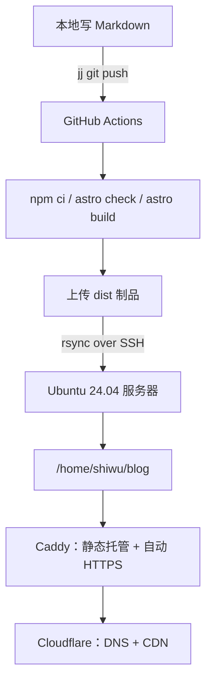
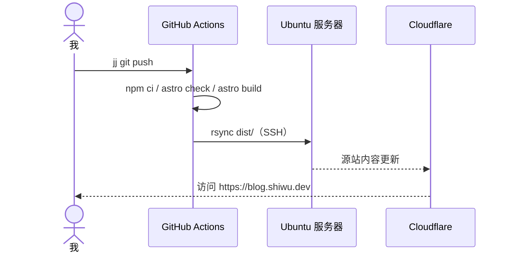

十月十七号下午，我先清理了服务器上用 Docker 部署的 memos 和 vaultwarden，顺手把 memos 里的笔记导出到了 Obsidian。收拾完这些，才开始折腾这个博客的部署。

主题是我自己挑的：对比了 [Ink](https://astro.build/themes/details/ink/)、[whono](https://astro.build/themes/details/astro-whono/) 和 [LogFlow](https://astro.build/themes/details/logflow/) 之后，最后选了 LogFlow——灰色调、衬线正文，看着舒服。

折腾到下午三点多，GitHub Actions 第二次报错，屏幕上只有一行：

```text
Process completed with exit code 255.
```

一共就失败了两次：第一次是 Secret 没配完，第二次就是这个 255。

<figure>
  
  <figcaption>图 1：那天下午的流程</figcaption>
</figure>

现在写完文章推一下，半分钟左右网站上就能看到。

## 我本来差点就用 Pages 了

一开始想得很简单：静态博客，放到 GitHub Pages 或者 Cloudflare Pages 上不就行了，免费、不用管服务器。

后来还是改了主意，原因有两个：一是我本来就有台云服务器，上面跑着几个自建服务；二是我确实想把这套东西完整走一遍，不然以后出了问题，都不知道该从哪查。

说白了，一半是需求，一半是想折腾。

代价也很直接：证书、权限、备份、安全，全都变成自己的事。如果你只是想安安静静写点东西，别学我。

## 最后长这样



拆开看就四件事：Cloudflare 负责域名解析，Caddy 负责 HTTPS 和静态文件，GitHub Actions 负责构建，一把 SSH 密钥负责把两边接起来。

## 域名：A 记录、橙云和 Full (strict)

在 Cloudflare 加一条 A 记录，指向服务器的公网 IP。

HTTPS 交给 Caddy：证书自动申请、自动续期。Cloudflare 这边代理开着橙云，SSL/TLS 模式用 **Full (strict)**，访问正常。

## 服务器：站点目录和一行权限

部署目录我放在 `/home/shiwu/blog`。没用 root 目录，也没用 `/var/www`，就放在自己的用户目录下。

站点在 `/home` 下面，Caddy 的运行用户需要能**穿过**家目录，才读得到里面的文件，所以部署脚本里做了这件事：

```bash
chmod o+x /home/shiwu
```

只允许进入，不允许列目录。脚本会在站点目录位于 `/home/*` 下时自动处理。

## Caddy：conf.d 和那个不生效的 404

服务器上的 Caddy 用 conf.d 分片管理站点，主 Caddyfile 只负责引入：

```caddyfile
# /etc/caddy/Caddyfile
import /etc/caddy/conf.d/*
```

站点配置单独放在 `/etc/caddy/conf.d/blog`。缓存策略、安全头这些是常规操作，真正让我踩坑的是 404。

我把 `404.html` 放进了站点根目录，访问一个不存在的地址，返回的却是一片空白。查文档才发现，Caddy 的 `file_server` 不会像 nginx 那样自动寻找 404 页面，必须显式配置：

```caddyfile
handle_errors {
    rewrite * /404.html
    file_server
}
```

加完这段，自定义 404 才生效。

## GitHub Actions：那个 255

这是这半天里最折腾的部分。

流程本身不复杂：GitHub Actions 构建完，用 rsync 通过 SSH 把 `dist/` 同步到服务器。为此得生成一对专用密钥：公钥放到服务器的 `authorized_keys`，私钥和服务器地址放进仓库的 Secrets。

顺带还有个小插曲：本机 PowerShell 一开始找不到 `scp`，最后用完整路径 `C:\WINDOWS\System32\OpenSSH\scp.exe` 才把部署文件传上去。

第一次失败是 Secret 还没填完，`Setup SSH agent` 直接报错。这个好办。

改完再推，第二次失败就是开头那个 `exit 255`。密钥是我自己生成的，生成命令是 AI 给的。AI 在工作流里加了一步 `Test SSH connection`，完整日志最后一行是：

```text
No ED25519 host key is known for ... and you have requested strict checking.
```

原来是我填的 `SSH_KNOWN_HOSTS` 里少了一行 ED25519 主机密钥，而且从 Windows 复制过来时还带了 CRLF 换行，OpenSSH 根本匹配不上。

<figure>
  
  <figcaption>图 2：两次失败的关键日志（示意）</figcaption>
</figure>

最后的办法是：写入前先去掉 `\r`，再用 `ssh-keyscan` 补全缺的密钥类型。

```bash
printf '%s\n' "${SSH_KNOWN_HOSTS}" | tr -d '\r' > ~/.ssh/known_hosts
ssh-keyscan -p "$PORT" "$SSH_HOST" 2>/dev/null | grep -v '^#' >> ~/.ssh/known_hosts
sort -u -o ~/.ssh/known_hosts ~/.ssh/known_hosts
```

这件事给我一个教训：**看到 255，先去读日志最后一行，别急着怀疑自己**。

前后一共跑了 6 次工作流：两次失败，后面成功的几次每次 30–40 秒。

## GitHub 贡献图：改了三轮

首页那张 GitHub 活跃度图是主题自带的，但真正用起来，前后改了好几轮。

**第一轮：标签和颜色。** 图上出现了两个「10 月」——原因是同一个月的第一天和中间某天都被标了月份。后来改成只在每月 1 日所在那一列标，并且相邻标签至少隔三周。颜色也不对：账号里只有一次贡献时，那一格直接显示成最亮的一档，看起来像天天在写代码。我把分档改成按实际次数来：0、1、2–3、4–8、9 次以上；只有一次贡献，就只是一格浅色。

**第二轮：手机上看不全。** 54 列按固定宽度排，窄屏只能横向滚动，视觉上就是被裁掉了。第一版用 CSS 容器查询把整年压缩到 5px 一格——确实完整了，但格子小到只能看个大概。最后改成两套布局：桌面显示完整一年，手机显示最近半年，格子按容器宽度自动算，手机上一格约 9px；标题旁的次数和描述也跟着切换成「最近半年」。

**第三轮：数据源。** 默认走的是免 token 的第三方公开接口，能用，但不够权威。后来加了一个只读的 `GH_TOKEN`，构建时改走 GitHub 官方 GraphQL；GraphQL 挂了会自动回退到公开接口，图不会消失。想让私密仓库的提交也计入，可以在 GitHub 个人资料设置里开启「Include private contributions on my profile」，只显示次数，不暴露内容。

顺带说清楚两件事：这张图是**构建时的快照**，不是实时的，每次部署才更新一次；格子的深浅是我按次数自己定的档，不是 GitHub 官方算法，鼠标悬停看得到真实次数。还有，没推上去的提交不会出现——它只统计 GitHub 上已经发生的贡献。

## 邮箱为什么显示成 `[email protected]`

关于页的邮箱有一阵子显示成 `[email protected]`，刷新一下又正常。我一开始以为是编码问题，问了 AI 才知道应该先去看 HTML 源码：

```html
<a href="/cdn-cgi/l/email-protection#...">
  <span class="__cf_email__" data-cfemail="...">[email protected]</span>
</a>
```

是 Cloudflare 的「邮箱地址混淆」（Scrape Shield 里的功能）干的：它在服务端把页面里的邮箱替换成占位符，再由注入的 `email-decode.min.js` 在浏览器里解码。

问题是博客用了 Astro 的 ClientRouter，换页是前端完成的。Cloudflare 的解码脚本只在整页加载时执行一次，从首页无刷新跳到关于页时它不会重跑，占位符就一直留在那里。

我试过让 AI 写一段兜底脚本：在每次 `astro:page-load` 后读取 `data-cfemail`、把十六进制转回字符，顺便把链接的 `href` 改回 `mailto:`。这个办法能解决换页，但解决不了首屏——服务器返回的 HTML 里本来就是占位符，脚本执行前必然闪一下。

最后的处理很简单：删掉兜底脚本，去 Cloudflare 把邮箱混淆关掉。邮箱本来就是公开的，关掉后服务端直接输出真实地址，首屏不闪、换页也不会再出问题，还少了一段 JS。

这件事的教训是：Cloudflare 上那些会改写 HTML 的功能（邮箱混淆、Rocket Loader 之类），和前端路由容易打架——它们都假设你每次是整页加载。

这些原因和解决方案，基本都是问了 AI 才搞明白的：它让我先看 HTML 源码，解释了 Cloudflare 的解码脚本为什么只在整页加载时跑、和 Astro 的前端路由怎么冲突，最后建议直接关掉混淆。我负责确认它说得对不对，以及在 Cloudflare 面板上点那几下。

## AI 帮了什么，没帮什么

标题里提了 DeepSeek Harness，是因为它在这件事里确实不只是“帮我写几行配置”。

**它最帮得上忙的是读日志和写配置。** 比如 255 那次，我还在怀疑密钥，它已经从上一条报错里挑出 known_hosts 的问题了。Caddyfile 和工作流也是它先起草，我再按自己的情况改。

**它也不是一次就写对。** 一开始 Caddy 只配了 `file_server`，自定义 404 没生效，上线后才发现，补了 `handle_errors` 才正常。

**有些事它替不了我。** 在 Cloudflare 面板点按钮、在服务器上跑 sudo、把私钥粘进 GitHub Secrets——这些都得自己来。

比较真实的感受是：跟 AI 一起干活，像和一个记性特别好、但不了解你现场环境的同事合作。你描述得越具体，它给的判断越准。只说一句“部署失败了”，得到的也只能是泛泛的建议。

## 现在的工作流

日常发布就两步，而且没有 `git add` 这一步。我用的是 Jujutsu（jj）而不是 git——它会把你正在改的内容自动当成一个提交，所以改完之后，直接让 AI 跑这两句：

```bash
jj commit -m "新文章"
jj git push
```

GitHub Actions 看的是远端分支上的 push，用 jj 推上去一样会触发构建。



看着 Actions 变绿、刷新后文章出现在网站上，确实挺爽的。前面那些 255、空白页，还有手机上被裁掉的贡献图，好像也值了。

<figure>
  
  <figcaption>图 3：部署成功后的 Actions 页面</figcaption>
</figure>

## 如果重来一次

- 先把 SSH 部署链路单独测通，再交给 Actions。
- 遇到报错先读完整日志，最后一行往往就是答案。
- 别赶时间，出错时更容易乱。

大概就这些。
