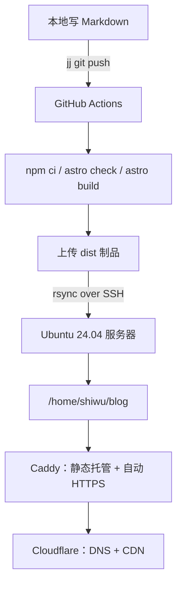
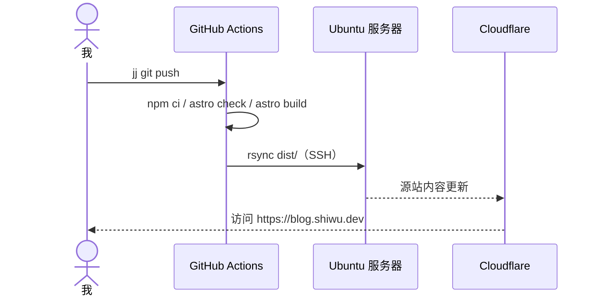

十月十七号下午，我先清理了服务器上用 Docker 部署的 memos 和 vaultwarden，然后才开始折腾这个博客。

主题是我自己挑的。翻了一圈 Astro 博客主题，最后选了 LogFlow Theme——灰色调、衬线正文，看着舒服。

折腾到下午四点多，GitHub Actions 第二次报错，屏幕上只有一行：

```text
Process completed with exit code 255.
```

一共就失败了两次：第一次是 Secret 没配完，第二次是这个 255。

<figure>
  
  <figcaption>图 1：那天下午的流程</figcaption>
</figure>

现在写完文章推一下，十来秒后网站上就能看到。

## 我本来差点就用 Pages 了

一开始想得很简单：静态博客，放到 GitHub Pages 或者 Cloudflare Pages 上不就行了，免费、不用管服务器。

后来还是改了主意，原因有两个：一是我本来就有台云服务器，上面跑着几个自建服务；二是我确实想把这套东西完整走一遍，不然以后出了问题，都不知道该从哪查。

说白了，一半是需求，一半是想折腾。

代价也很直接：证书、权限、备份、安全，全都变成自己的事。如果你只是想安安静静写点东西，别学我。

## 最后长这样



拆开看就四件事：Cloudflare 负责域名解析，Caddy 负责 HTTPS 和静态文件，GitHub Actions 负责构建，一把 SSH 密钥负责把两边接起来。

## 域名：先别急着开橙色云

在 Cloudflare 加一条 A 记录，指向服务器的公网 IP。这一步没什么好说的。

关键是代理状态。我一开始顺手就开了橙云（Proxied），结果 Caddy 申请证书的时候一直失败。后来把代理切回灰云（DNS only），证书几分钟就签下来了，再切回橙云、SSL/TLS 模式改成 **Full (strict)**，一切正常。

顺序是 AI 提醒我的。它当时说“你先把灰云跑通，再考虑代理”，我照做了。事后想想确实是这个道理，只是我一开始太想一步到位。

## 服务器：一个 403 换来的 o+x

部署目录我放在 `/home/shiwu/blog`。没用 root 目录，也没用 `/var/www`，就放在自己的用户目录下。

结果 Caddy 返回了 403。

排查了一会儿才明白：站点在 `/home` 下面，Caddy 的运行用户得能**穿过**家目录，才读得到里面的文件。而家目录默认是 `drwxr-x---`，Caddy 进不去。

```bash
chmod o+x /home/shiwu
```

只允许进入，不允许列目录。改完 403 就没了。

这种问题就属于“不知道的话能卡半天，知道了就是一行命令”。

## Caddy：conf.d 和那个不生效的 404

服务器上的 Caddy 用 conf.d 分片管理站点，主 Caddyfile 只负责引入：

```caddyfile
# /etc/caddy/Caddyfile
import /etc/caddy/conf.d/*
```

站点配置单独放在 `/etc/caddy/conf.d/blog`。缓存策略、安全头这些是常规操作，真正让我踩坑的是 404。

我把 `404.html` 放进了站点根目录，访问一个不存在的地址，返回的却是一片空白。查文档才发现，Caddy 的 `file_server` 不会像 nginx 那样自动寻找 404 页面，必须显式配置：

```caddyfile
handle_errors {
    rewrite * /404.html
    file_server
}
```

加完这段，自定义 404 才生效。

## GitHub Actions：那个 255

这是这半天里最折腾的部分。

流程本身不复杂：GitHub Actions 构建完，用 rsync 通过 SSH 把 `dist/` 同步到服务器。为此得生成一对专用密钥：公钥放到服务器的 `authorized_keys`，私钥和服务器地址放进仓库的 Secrets。

第一次失败是 Secret 还没填完，`Setup SSH agent` 直接报错。这个好办。

改完再推，第二次失败就是开头那个 `exit 255`。我一开始怀疑是密钥格式问题，把 `authorized_keys` 翻来覆去检查了两遍，还重新生成过一次密钥。折腾半天，问题根本不在这。

AI 让我把 `Test SSH connection` 这一步的完整日志拉出来。日志最后一行是：

```text
No ED25519 host key is known for ... and you have requested strict checking.
```

原来是我填的 `SSH_KNOWN_HOSTS` 里少了一行 ED25519 主机密钥，而且从 Windows 复制过来时还带了 CRLF 换行，OpenSSH 根本匹配不上。

<figure>
  
  <figcaption>图 2：两次失败的关键日志（示意）</figcaption>
</figure>

最后的办法是：写入前先去掉 `\r`，再用 `ssh-keyscan` 补全缺的密钥类型。

```bash
printf '%s\n' "${SSH_KNOWN_HOSTS}" | tr -d '\r' > ~/.ssh/known_hosts
ssh-keyscan -p "$PORT" "$SSH_HOST" 2>/dev/null | grep -v '^#' >> ~/.ssh/known_hosts
sort -u -o ~/.ssh/known_hosts ~/.ssh/known_hosts
```

这件事给我一个教训：**看到 255，先去读日志最后一行，别急着怀疑自己**。

## 顺手修的几个小问题

- `scp` 明明装了却提示找不到，最后用完整路径解决的：`C:\WINDOWS\System32\OpenSSH\scp.exe`。
- 关于页的邮箱会显示成 `[email protected]`，刷新一下又正常。原因是 Cloudflare 的邮箱混淆和 Astro 的无刷新换页打架，后来加了个解码兜底。
- 手机上看首页的贡献图被裁掉一截。最后改成桌面显示一年、手机显示半年，格子按容器宽度自适应。

都是小问题，有 AI 帮忙查，很快就解决了。

## AI 帮了什么，没帮什么

标题里提了 DeepSeek Harness，是因为它在这件事里确实不只是“帮我写几行配置”。

**它最帮得上忙的是读日志和写配置。** 比如 255 那次，我还在怀疑密钥，它已经从上一条报错里挑出 known_hosts 的问题了。Caddyfile 和工作流也是它先起草，我再按自己的情况改。

**它也会带错方向。** 中间它建议我直接开橙云，我照做，结果证书失败，又切回灰云。后来想想，它一开始就说过“先灰云”，是我自己没听。

**有些事它替不了我。** 在 Cloudflare 面板点按钮、在服务器上跑 sudo、把私钥粘进 GitHub Secrets——这些都得自己来。

比较真实的感受是：跟 AI 一起干活，像和一个记性特别好、但不了解你现场环境的同事合作。你描述得越具体，它给的判断越准。只说一句“部署失败了”，得到的也只能是泛泛的建议。

## 现在的工作流

日常发布就两步，而且没有 `git add` 这一步。我用的是 Jujutsu（jj）而不是 git——它会把你正在改的内容自动当成一个提交，所以改完之后，直接让 AI 跑这两句：

```bash
jj commit -m "新文章"
jj git push
```

GitHub Actions 看的是远端分支上的 push，用 jj 推上去一样会触发构建。



看着 Actions 变绿、刷新后文章出现在网站上，确实挺爽的。前面那些 403、255 和空白页，好像也值了。

<figure>
  
  <figcaption>图 3：部署成功后的 Actions 页面</figcaption>
</figure>

## 如果重来一次

- 先灰云，证书签好再开橙云。
- 遇到报错先读完整日志，最后一行往往就是答案。
- 别赶时间，出错时更容易乱。

大概就这些。
